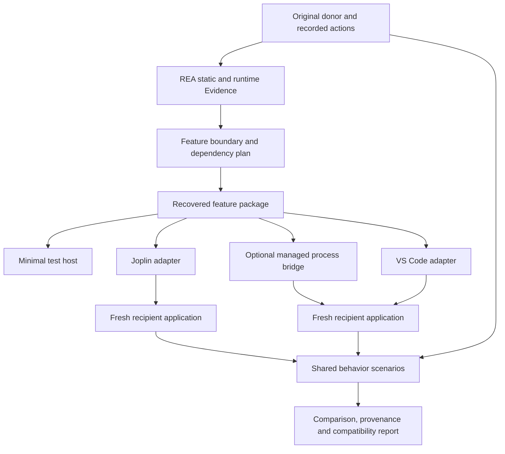

# Yoinkr phase 2: repeatable desktop feature transfers

Written 2026-10-18. Baseline: Yoinkr v0.18. Status: **milestones 17–23 delivered in v0.19–v0.25; milestone 24 in progress in v0.26 (Windows native acceptance open)**.

Phase 1 delivered 16 milestones establishing investigation, original-file recovery, integration recipes, verification, a local workbench and standalone MCP tools. Phase 2 adds **8 milestones, numbered 17–24**. The combined roadmap now has 24 scoped milestones: 23 delivered and 1 planned. Release version numbers will be assigned as the new milestones ship.

The product objective is to let someone identify a feature in one desktop application, recover a runnable implementation, connect it to another application's services, and verify the result. Success means progressively less custom engineering for each additional recipient. Completing analysis or copying a utility function alone does not establish a complete feature transfer.

## Contents

- [Outcomes and scope](#1-outcomes-and-scope)
- [Current strengths and gaps](#2-current-strengths-and-concrete-gaps)
- [First reference transfer](#3-first-reference-transfer)
- [User workflow](#4-user-workflow)
- [Architecture and contracts](#5-architecture-and-contracts)
- [Eight milestones and their acceptance gates](#6-milestone-sequence)
- [Acceptance and performance targets](#7-acceptance-matrix-and-performance-targets)
- [Engineering guardrails](#8-product-and-engineering-guardrails)
- [Risks and scope decisions](#9-risks-decisions-and-how-to-contain-scope)
- [Immediate implementation order](#10-immediate-implementation-order)

## 1. Outcomes and scope

Phase 2 is complete when all of these outcomes have retained evidence:

1. A real, visible donor feature—including its original interface code and behavior—runs inside two different real desktop applications.
2. Both recipients use the **same immutable feature package**, with the same package digest. Recipient-specific changes live in adapters and configuration.
3. A user can demonstrate the donor feature and inspect suggested implementation locations, dependency requirements and unresolved relationships before recovery.
4. The package can be built from pinned inputs on a fresh checkout, without earlier local Yoinkr builds or personal directory paths.
5. The same declared behavior scenarios run against the original donor and both recipients, with explicit differences and performance results.
6. An incompatible recipient update is refused; a supported update can be assessed, repaired in a fresh copy and reverified.
7. A separate process-bridge route has one real component proof, including crash recovery and cleanup.
8. The CLI and workbench provide the full supported workflow. Compatible agents can use it through standard MCP. DSH, a particular model provider and cloud tokens are not prerequisites.

The first supported delivery target is Linux x86-64 Electron applications. Phase 2 includes a Windows reproducibility and verification lane before claiming Windows support. macOS and additional architectures remain named future targets unless equivalent evidence is added. Cross-platform JavaScript tests alone do not establish native application support.

Further .NET, Qt, GTK, Firefox and Chromium-native integrations will use their own scoped adapters. A managed process bridge can support some cross-runtime behavior without implying that arbitrary UI or binary code becomes portable.

## 2. Current strengths and concrete gaps

| Area | Delivered foundation | Phase 2 change |
|---|---|---|
| Finding implementation | REA graphs, explicit seeds, source inspection | Recorded feature demonstrations linked to candidate code and runtime observations |
| Recovery | Physical files and explicit assets from directories/ASAR | Runnable package with dependencies, initialization, state and one supported bundled-module recovery path |
| Dependency classification | Hand-authored classifications in demonstrations | Reusable dependency plan with blocking unknowns and per-dependency disposition |
| Integration | Hash-checked module recipes and Electron playbooks | A common feature contract with independent recipient adapters |
| UI | Manual examples, browser replay, specific native tests | Shared scenarios against original donor and real recipients |
| Portability | One-off native builders and fixture comparisons | Identical recovered package demonstrated in two independently implemented hosts |
| Updates | Exact-version and file-drift refusal | Evidence-backed candidate repair, fresh-copy validation and rollback |
| Distribution | Standalone project and MCP config generation | Portable recipe distribution, fresh-machine demonstrations and explicit platform support |

The [MQTT showcase](SHOWCASE.md) genuinely reuses donor models and formatting. The [plotting showcase](NATIVE_PLOT_TRANSFER.md) reuses donor numeric conversion while supplying a new chart interface. Phase 2 must preserve this distinction in every report and advance the amount of visible behavior actually recovered.

## 3. First reference transfer

### Donor feature

Use **MQTT Explorer's Raw/Diff payload comparison panel** as the primary candidate. This is a bounded user-facing feature, rather than the entire MQTT client or every feature in its sidebar.

The inspected donor source includes `Sidebar/ValueRenderer/ValueRenderer.tsx`, `ActionButtons.tsx` and `Sidebar/CodeDiff/`, with React/Redux, styling, Prism, diffing and message-model dependencies. These are investigation starting points, not a claim that the dependency set is already complete. Milestone 17 must pin the exact donor revision and prove the panel's behavior in a matching original application.

The initial behavior contract should cover:

- Displaying the current payload and comparing it with the previous or explicitly selected message.
- Raw and Diff modes, preserving the original mode controls, comparison rendering and change indicators.
- JSON formatting/highlighting and text fallback as actually observed in the pinned donor.
- Empty data, missing previous messages, Unicode, malformed JSON and long inputs within declared limits.
- Selecting/copying rendered content, keyboard focus, resizing, theme handling and repeated message updates.
- Switching the selected topic/message without retaining another topic's stale comparison.

Freeze the final list against the original donor in milestone 17. A behavior absent from that donor version cannot be presented as copied behavior. Existing links into plotting, retained-message deletion, publishing, specialized decoders or other sidebar features must be classified explicitly: include the needed implementation, provide a declared host capability, or visibly omit/disable the unsupported control. No working-looking button may silently do nothing.

The primary proof must retain original UI components and comparison logic. A newly written lookalike can be recorded as a reconstruction experiment, but cannot close this transfer milestone. Necessary boundary adaptations are allowed when separately recorded and behavior-tested.

### Recipients

- **First: VS Code / Code-OSS desktop.** Reuse knowledge from the existing integration while building from a fresh pinned runtime. Prefer a reproducible Code-OSS build for the public example; record the actual distribution used.
- **Second: Joplin desktop.** This tests a different application and state model within the Electron family. Joplin's documented Electron/React/Node architecture makes it a reasonable candidate, not an established compatibility result. [Joplin architecture](https://joplinapp.org/help/dev/spec/architecture/).

Both primary demonstrations use a reviewed runtime copy or source-built application integration, without installing a marketplace extension. A recipient-owned tool window is an acceptable first mounting surface; reports must identify it as a window rather than imply integration into the existing editor pane. At least one host action must pass real data from the recipient's UI into the transferred comparison feature, such as comparing two selected text snapshots. Replaying only synthetic messages in an unrelated window is insufficient.

Joplin's real notes/profile are never needed for the demonstration: use a temporary profile and sample notes. Freeze tested versions and mount locations in milestone 17. If a recipient proves infeasible, retain the failure analysis and explicitly revise the target; do not quietly substitute a trivial fixture host.

### Strong portability test

Recover and freeze the feature package before integrating the second recipient. If that integration exposes a genuine defect in the shared contract, revise the package, rebuild it once, and reverify **both** recipients against the same new digest. No recipient fork may be hidden inside the shared feature.

## 4. User workflow

1. **Choose applications.** Select the donor and recipient paths or pinned source builds. See platform/version support and prerequisites.
2. **Show the feature.** Start an owned donor lab session, record a short interaction, and mark the visible component or action of interest. A manual seed remains available.
3. **Review the proposed boundary.** See candidate modules, assets, state, services and unknown dependencies. Runtime observations and static inferences have distinct labels.
4. **Prepare the package.** Recover originals, apply recorded transformations, resolve pinned dependencies, build, and run the feature in a minimal test host.
5. **Choose placement and services.** Select a supported recipient adapter and mounting surface. Review required capabilities and any unavailable behavior.
6. **Try a fresh recipient copy.** Apply the integration, launch with a separate profile, and exercise the feature using recipient data.
7. **Compare behavior.** Run shared donor/recipient scenarios and inspect functional, visual, lifecycle and performance results.
8. **Keep or share the recipe.** Retain exact versions, package digest, adapter, requirements, provenance and acceptance. Export portable recipes with private data excluded.
9. **Handle an update.** Compare the new application version, review candidate changes, rebuild a fresh copy and rerun the relevant scenarios.

The workbench should show progress, failures and next actions in ordinary language. Detailed graphs, source locations and raw Evidence remain available as inspection views. The user should not need to understand an internal record schema to run a supported recipe.

## 5. Architecture and contracts

### Reuse the existing core

Extend REA integration, case integrity checks, source inspection, module verification, browser replay, Electron playbooks, the prior-work library and bounded MCP jobs. Do not implement a second decompiler or duplicate REA's analysis catalog.

REA's existing workflow describes retained graph queries, traces and version comparisons. Use the exact contracts available in Yoinkr's pinned dependency, with explicit capability checks before using APIs documented only on upstream main. [REA application workflows](https://github.com/morluto/rea/blob/main/docs/javascript-application-workflows.md).

The implementation should add focused modules near their existing owners. Suggested areas, subject to normal code review:

| Proposed area | Responsibility |
|---|---|
| `src/feature-session.js` | Owned donor sessions, action records and Evidence links |
| `src/feature-plan.js` | Boundary, dependency dispositions and route decisions |
| `src/feature-package.js` | Package validation, recovery, transforms and integrity |
| `src/host-adapters/` | Versioned capability contracts and recipient integrations |
| `src/feature-verify.js` | Shared scenarios and normalized comparison reports |
| `src/component-bridge.js` | Bounded component process lifecycle and protocol |
| `src/transfer-update.js` | Compatibility assessment and candidate repair plans |
| `recipes/` and `schemas/` | Portable reference recipes and documented contracts |

These names describe planned ownership; none are existing commands or implemented modules merely because they appear here.

### Feature observation

Separate passive observation from action replay. Passive capture can suggest which scripts, handlers and messages relate to an interaction; correlation alone does not establish causation. Preserve the time window, selected target, source digests, exclusions and truncation.

Where available, use REA runtime capture, listener inspection and static/runtime reconciliation. Reuse Yoinkr's declared UI actions for active replay, adding only missing desktop support. Do not infer that an entire bundle or every contained module executed because the bundle was observed. Whole-OS event recording and arbitrary native UI instrumentation are outside the first observer.

Sessions use owned app processes and temporary profiles by default. Existing app attachment is an explicit selected-session option. Capture starts and ends visibly, supports cancel/cleanup, and records whether the tool or user performed each action. Observe files/network messages only through declared sources; absent observations remain unknown.

### Dependency plan

Each dependency has a stable identity, input hash where available, supporting Evidence, process context and a disposition:

- Recover unchanged code or an asset.
- Reconstruct a module from a supported bundle while retaining its original context and provenance.
- Resolve a pinned external package.
- Supply a recipient capability through an adapter.
- Keep behavior behind a process bridge.
- Apply an explicit, reviewable boundary transformation.
- Leave unresolved and block the applicable verification/release claim.

Include CSS imports, fonts, images, workers, lazy chunks, native modules, shared singleton state, lifecycle hooks and side effects—not just static JavaScript imports. A dependency absent from a partial graph cannot be assumed unnecessary. Imported code is never executed simply to discover its dependencies.

### Feature package

A versioned package should contain:

| Record/content | Required information |
|---|---|
| Manifest | Feature ID/version, schema, supported runtime, entry points, input/event/state contracts and required capabilities |
| Original sources/assets | Exact recovered bytes and extraction locations, with hashes |
| Dependency lock | Exact package versions/integrities, runtime requirements and dependency dispositions |
| Transform log | Compiler/build versions, wrapper changes, import mappings, patches and original/result hashes |
| Built payload | Renderer/controller/component outputs and integrity manifest |
| Provenance | Donor identity, REA Evidence links, attribution and distribution status of included material |
| Acceptance references | Scenario definitions and expected donor behavior; reports remain immutable run artifacts |

Give the semantic package a canonical content digest independent of timestamps and absolute machine paths. Keep recipient adapters outside that digest. Record build-environment details separately; reproducibility tests should identify any nondeterministic outputs rather than merely accept a new hash.

The initial recovered feature API is conceptually `mount`, `update`, `snapshot` and `dispose`. Host services are provided as explicit capabilities. Do not require donor React components to adopt a new UI framework or share the recipient's React singleton. An isolated renderer can carry the donor's required UI dependencies while interacting through the common contract.

Package preparation validates and builds declared inputs. Dependency acquisition is a distinct step using a lockfile/cache; ordinary replay is local once dependencies are present. Unsupported bundlers, missing lazy chunks and unresolved native bindings produce actionable refusals. They are not repaired by silently copying the entire donor installation.

### Recipient adapter

An adapter declares exact supported host identities and surfaces, required application changes, a capability map, lifecycle handling, rollback and its own acceptance tests. Initial capabilities should be small and concrete: mount a tool surface, register a command/shortcut, receive selected content, copy text, open/save a chosen file, read theme changes and store feature-scoped settings.

Each adapter implements discovery/probing, a read-only integration plan, installation into a fresh copy, activation, disposal, health inspection and rollback. Application-specific imports or private globals belong in the adapter. The feature package uses documented input/state/capability contracts.

Electron's main, preload and renderer responsibilities must remain explicit. Keep sender checks and bounded IPC, and avoid injecting donor CSS or globals into unrelated recipient views. [Electron process model](https://www.electronjs.org/docs/latest/tutorial/process-model).

Settings are namespaced by feature and adapter version. Removing a feature disposes commands, subscriptions, timers, styles and owned processes. Adapters must detect conflicting mount IDs/shortcuts rather than overwrite another feature silently. Two feature instances must not share accidental global state.

### Process bridge

Provide an optional route for a component that remains in its original runtime. Begin with child-process stdio using framed, versioned requests, correlation IDs, a startup handshake, bounded payloads, timeouts, cancellation and backpressure. The supervisor owns process cleanup and distinguishes startup failure, protocol failure, operation failure and crash.

Use registered executable/component profiles and fixed operations, not an unrestricted remote shell. After a crash, pending calls fail explicitly; requests with side effects are never blindly replayed. A restarted process performs a fresh handshake and restores only declared state.

The first cross-runtime demonstration can reuse the existing original zlib library through its Python/ctypes adapter, now invoked by an actual recipient feature such as a file checksum action. Compare the returned checksum with an independent reference and exercise crash/restart. Label the compiled library as recovered and the protocol/UI adapter as newly written. This validates a bridge route separately from the original-UI portability proof.

### Records, jobs and existing data

Keep existing schema-1 cases, workspaces and verification records readable. Add separately versioned records for feature plans, packages, host bindings and comparisons rather than rewriting historical Evidence. Every report binds source package, adapter, host, scenario and build identities.

Long operations use durable stages and retained output with the existing bounded paging approach. After a restart, incomplete work is marked interrupted. Resume only validated, repeatable stages; require a fresh explicit operation for uncertain side effects. Never turn a process exit or an interrupted run into a passing comparison.

Extend the workbench, CLI and MCP from the same operation services. Registration, write and execution boundaries remain explicit. Model output can propose a plan or patch, but passes through the same schema, integrity and acceptance checks as a hand-authored recipe.

## 6. Milestone sequence

| ID | Milestone | Depends on | Main proof | Status |
|---|---|---|---|---|
| 17 | Observe and define the first feature | Phase 1 | Matching original donor, frozen scope and traceable observations; [v0.19 delivery](FEATURE_BASELINES.md) | Delivered |
| 18 | Build a runnable recovered package | 17 | Original UI, source and actual webpack recovery, repeat builds and lifecycle proof; [v0.20 delivery](FEATURE_PACKAGES.md) | Delivered |
| 19 | Deliver the first recipient adapter | 18 | Actual VS Code 1.142.0 copy, native editor selections, frozen package, host services and real rollback; [v0.21 delivery](FEATURE_HOSTS.md) | Delivered |
| 20 | Compare donor and recipient behavior | 17, 19 | Shared scenarios, real lifecycle and performance; [v0.22 delivery](SHARED_FEATURE_VERIFICATION.md) | Delivered |
| 21 | Prove reuse in a second real recipient | 18–20 | Same package digest runs in actual Joplin with a separate adapter; [v0.23 proof](SECOND_HOST.md) | Delivered |
| 22 | Deliver a managed process bridge | 18, 19; reuses 20 | Real zlib component, framed supervision, actual file action and rollback; [v0.24 proof](COMPONENT_BRIDGE.md) | Delivered |
| 23 | Handle application version changes | 20, 21 | Real 1.142.0/1.141.0 pair, structural repair, scoped REA and real rollback; [v0.25 proof](ADAPTER_REPAIR.md) | Delivered |
| 24 | Ship portable recipes and guided delivery | 17–23 | Portable recipes, workbench/CLI/MCP delivery and Linux replay; [scope](PORTABLE_DELIVERY.md); Windows native acceptance open | In progress |

The first useful vertical result ships at milestone 19. The central reusability proof is milestone 21. Milestones 22–24 make the approach useful across runtime boundaries, updates and other people's machines. Do not delay all visible feature work until a generic framework is finished.

### Milestone 17 — Observe and freeze the feature contract

Deliver an owned donor session workflow, explicit feature selection, action/capture records and a first boundary/dependency report. Start with deterministic scripted actions plus manual markers; add recording support only for the interactions the proof needs. Connect observed targets/scripts/listeners to existing REA Evidence with confidence and limitations.

Tasks:

- Pin donor source/artifact and compatible original-app build; establish their relationship with hashes or an explicit source-build record.
- Probe both intended recipients and record the proposed mount surfaces and capability requirements.
- Run the original panel with controlled input messages and save baseline scenarios, UI captures and expected behavior.
- Freeze required, optional and excluded actions; list all controls and cross-feature links in the selected component.
- Establish input sizes, expected resource costs and the benchmark machine/environment.
- Create a portable reference recipe layout with paths supplied through inputs, never prior Yoinkr build directories.

Acceptance: another local run reproduces the baseline from pinned inputs; both ambiguous and missing observations remain visible; stopping/cancelling the session leaves no owned app/debugger/broker processes. A component-only mount is useful supplemental evidence, but cannot stand in for the original donor application baseline.

If the primary donor cannot be built/launched or its feature boundary is substantially different, produce a concrete blocker report and revised candidate. The milestone remains open until a real donor baseline exists.

### Milestone 18 — Recover and build the runnable package

Implement the dependency plan, package schema/validator, immutable originals, transformations and build manifest. Recover the actual Raw/Diff UI and logic with the necessary state providers and assets. Add a minimal host for quick iteration and original-component comparison.

Support source-directory recovery first, then one explicitly identified bundle format/layout found in the pinned donor's build. A bundle module needs more than a source range: retain wrapper bindings, external references, module loader assumptions and any supported lazy chunks. Reuse REA reconstruction/source-map facts where present; refuse unsupported layout or unresolved closure.

Acceptance: the package mounts, updates and disposes in the test host with original UI components; removed assets/dependencies cause a useful diagnostic; tampered source/lock/transform inputs fail; an unsupported bundle fails honestly. Demonstrate both the source path and the supported bundle path against a real donor build, supplemented by adversarial fixtures. Build twice from the same cached inputs and compare package digests. No application-specific recipient imports enter the package.

### Milestone 19 — First real recipient adapter

Implement the common adapter contract and a VS Code/Code-OSS adapter. Refactor reusable parts of existing bootstrap, preload and playbook code; replace demonstration-specific path assumptions with declared inputs.

Tasks include command/menu access, an application-owned mounting surface, selected-content/message input, theme integration, clipboard/file capabilities actually needed by the feature, profile isolation, disposal, installation plan and rollback. Code generation may scaffold an adapter, but the exact bootstrap and behavior require verification.

Acceptance: a fresh actual recipient opens the original donor panel and compares data supplied by a real recipient action. Extensions are disabled/not installed for the primary proof. The recipient's existing editing/navigation behavior still works. Closing/reopening the feature, restoring a lab session and rolling back are exercised. The original application install and normal profile match their pre-run checks. A blank tool window or fixture shell does not pass.

### Milestone 20 — Shared donor/recipient acceptance

Extend the existing verifier with one scenario representation and environment drivers for the original donor, minimal host and actual recipient. Semantic actions are shared; environment-specific selectors and setup are separately versioned and logged.

Compare decoded/formatted values, diff hunks/counts, visible state, event ordering, selected-content changes, clipboard/file output, settings and cleanup. Capture screenshots for visual structure and missing/misaligned controls; normalize only declared nondeterminism such as timestamps and window chrome. Pixel similarity alone is not functional acceptance.

Acceptance: the full frozen suite passes; intentionally broken recipient output, missing CSS, stale selection and a leaking subscription produce failures. Every run retains raw and normalized observations, normalization rules and differences. A successful job with failed assertions is a failed feature comparison. Module, component, donor-app and recipient-app outcomes remain separately visible.

### Milestone 21 — Second host and reuse proof

Implement the Joplin adapter against the same shared feature contract. Use a fresh profile with sample notes and a real application action that passes note/text snapshots to the comparison panel. Introduce no Joplin-specific branches in recovered feature code.

Acceptance: both real recipients run the identical package digest and shared scenario version. Each has its own adapter, selectors, version probe and rollback. A new person following the recipe can prepare the second host without changing the feature package. Any shared-package revision triggers verification of both recipients. Record which work was reused, what recipient-specific code was added, manual decisions, preparation time and ongoing compatibility cost.

This is the main generalization checkpoint. If most feature code must be rewritten for the second host, retain the result and revise the contract; do not declare reusable transfer based on two unrelated implementations.

### Milestone 22 — Component process bridge

Implement the supervisor/protocol described above and connect the existing zlib component through an actual recipient action. Use the same package/provenance and scenario concepts where appropriate without forcing a native component to masquerade as a renderer feature.

Acceptance: independent checksum vectors agree; malformed/oversized requests and mismatched protocol versions fail; cancellation releases work; a forced child crash fails pending calls and permits a fresh, verified restart; repeated operations remain bounded; removing the feature or closing the app leaves no bridge process. Confirm source files are handled according to the declared operation and no normal app profile is required.

Record latency and resource costs. Separate-process execution is a lifecycle/isolation mechanism, not a blanket hostile-code sandbox claim.

### Milestone 23 — Version assessment and repair

Use existing drift checks plus REA version comparison to assess an actual supported recipient version and a second real version. Map changed hook sites, imports and capabilities into a read-only repair proposal with exact Evidence and ambiguities.

Implement reviewed structural patches where feasible, with exact preconditions and output hashes. A pattern matching several sites, a missing capability or a changed package contract blocks automatic application. Proposed repairs create fresh copies and run the relevant donor/recipient acceptance before becoming a new supported binding.

Acceptance: demonstrate an unchanged-compatible case, a real changed-version repair, an intentionally ambiguous/broken case that is refused, and rollback after the changed version's validation. Preserve the older adapter and report. A text offset moving is not sufficient evidence that a patch is safe; package and scenario identity must remain bound.

### Milestone 24 — Public reproducibility and guided workflow

Finish the supported workbench journey and equivalent CLI/MCP operations. Reuse the existing standalone setup; no agent host is required. Add prerequisite checks, clearly scoped progress/failure messages, inspection of package/adapter/verification status and a readable result showing exactly what was transferred.

Package the reference recipes with pinned input acquisition/build instructions, integrity metadata, attribution, platform requirements, sample data and acceptance commands. Include authorized redistributable components where appropriate; otherwise provide a recipe that uses the user's local donor files. Keep credentials, user content, local installation paths and previous private builds out of public examples. Unknown provenance/distribution status is visible rather than silently guessed.

Acceptance: from a clean checkout and empty Yoinkr build directories, a tester supplies documented inputs and reproduces both recipient demonstrations. Repeat with cached dependencies and networking disabled for the replay stage. Run supported Linux and Windows lanes; publish exact verified versions and mark unsupported combinations accurately. Validate installation/rollback, a recipe import/export round trip and the original-code-versus-new-glue report. GitHub publication itself is a separate explicit release action, not an automatic side effect of building a recipe.

## 7. Acceptance matrix and performance targets

Milestone 17 freezes scenario inputs and measurement thresholds before integration changes are judged. These are starting targets to validate against the donor baseline, not claims about current performance.

| Dimension | Minimum evidence |
|---|---|
| Original behavior | Same payload corpus, mode changes, selected-history comparison and output assertions in donor and recipients |
| UI completeness | Required original controls render and work; unsupported cross-feature controls are explicitly identified |
| Host integration | Real host command/data path, focus/keyboard behavior, theme changes and normal host operation |
| Lifecycle | 50 open/use/close cycles, app restart, two independent feature instances and cleanup of subscriptions/processes |
| Data boundaries | Empty, Unicode, malformed and large input; output identity; stale-selection and cross-instance tests |
| Failure | Missing dependency, corrupted package, broken adapter, worker crash and interrupted preparation |
| Fidelity | Logical output, accessibility/DOM state where available and selected visual comparisons with declared tolerances |
| Update | Pinned real version pair, candidate repair, refusal of ambiguous matches and verified rollback |
| Reproduction | Fresh checkout, supplied input paths, locked dependencies and identical shared package in both hosts |

Use a controlled corpus with small (about 1 KiB), normal (about 10 KiB), medium (about 100 KiB) and stress inputs up to an agreed cap. Freeze the actual cap after measuring donor behavior; a slow original algorithm may need a declared limit or recorded adaptation. Do not silently truncate payloads or change comparison semantics to pass a benchmark.

Provisional performance gates on the declared benchmark machine:

- Recipient host startup overhead with the feature unopened: no more than the larger of 200 ms or 10% of baseline startup.
- Warm feature opening: p95 at or below one second on the normal corpus.
- Normal comparison updates: p95 overhead relative to the matching donor component no more than the larger of 50 ms or 25% of its baseline.
- After warm-up and 50 open/close cycles: no accumulating owned processes, listeners or timers; retained feature heap growth no more than the larger of 16 MiB or 10% of the warm baseline using a documented measurement method.
- Process bridge: bounded queue/request sizes, no unbounded pending-call growth, and recorded p50/p95 overhead by payload size.

Measure each phase separately: capture, analysis, build, integration and runtime use. Report app/runtime versions, hardware, display scale, sample counts and variance. Adjust a provisional target only through an explicit baseline decision with a reason; never revise a gate silently after a failing comparison. Benchmark results from shared CI runners are trends unless the runner is stable enough for the stated gate.

## 8. Product and engineering guardrails

- **A copied feature must be identified honestly.** Reports distinguish recovered originals, compilation, compatibility patches, host glue and reconstruction. Line counts alone do not measure behavioral fidelity.
- **The core remains local.** Pinned analysis, recovery, replay and recipe execution need no model calls. Models can assist investigation or generate candidate glue through optional standard MCP access.
- **Use explicit routes.** Direct transfer, conversion, reconstruction and process bridging have different runtime and ownership assumptions. Record route changes; Universal Modder's route guidance also emphasizes per-host contracts. [Route selection reference](https://github.com/rehan-remade/universal-modder/blob/main/knowledge/techniques/choosing-a-mashup-route.md).
- **Preserve old evidence.** New runs and repaired bindings are append-only records; historical passes keep their original input identities.
- **Apply to working copies.** Keep backups, exact patch bases, staged writes and interruption records. Never label a partially applied or partially rolled-back workspace clean.
- **Keep public recipes portable.** Machine-specific paths are supplied inputs, not committed defaults. Recipe authoring and runtime code execution have distinct responsibilities.
- **Limit unsupported combinations visibly.** Runtime similarity and a successful launch do not imply compatible application services.

## 9. Risks, decisions and how to contain scope

| Risk/unknown | Response and decision point |
|---|---|
| Donor panel depends on most of its application | Measure dependency closure in 17–18; introduce explicit state/service boundaries. Revise the named feature openly if it cannot be isolated. |
| Original source and installed artifact differ | Pin a reproducible matching donor build or retain a validated relationship; do not combine unrelated source with runtime observations. |
| Bundle extraction requires unsupported loader semantics | Name one supported layout, retain unresolved bindings and block that path until tested. Source-only success cannot close the bundle requirement. |
| Donor React/styles conflict with host runtime | Keep feature rendering isolated and exchange typed state/events; test theme, focus and accessibility explicitly. |
| Second host forces feature-specific rewrites | Treat this as a failed portability experiment and improve the contract before claiming milestone 21. |
| User-visible behavior depends on external services | Use an owned broker/local fixtures; separately declare any real-service prerequisite. |
| Adapter breaks on host updates | Exact compatibility checks, retained older bindings and milestone 23 repair verification. |
| Native tests differ across operating systems | Implement one platform first, record actual support and add the second verified lane before broad claims. |
| Public recipe cannot redistribute a donor artifact | Ship acquisition/local-input instructions and recipe metadata; keep private artifacts separate. |
| Framework work expands without useful transfers | Require real-host checkpoints at 19 and 21; defer unrelated capability APIs until a second real consumer needs them. |

No fixed delivery dates are assigned yet. Milestone 17 supplies the evidence needed to estimate the risky extraction and host-integration work. Progress should be reported by completed acceptance gates and unresolved blockers, rather than the number of tools, generated files or screenshots.

## 10. Immediate implementation order

Milestone 17 is delivered: the original desktop app passes 83 declared actions and 38 assertions with unchanged tracked sources, repeat captures, static recipient probes, passive REA Evidence and cancellation cleanup. The baseline identified the actual `DetailsTab` entry, a stale-view defect, debounced selection and empty-payload topic removal. See [delivery scope and reproduction](FEATURE_BASELINES.md). Milestone 18 is delivered in v0.20; see [package recovery and proof](FEATURE_PACKAGES.md). Milestone 19 is delivered in v0.21; see [native recipient integration and proof](FEATURE_HOSTS.md). Milestone 20 is delivered in v0.22; see [shared acceptance](SHARED_FEATURE_VERIFICATION.md). Milestone 21 is delivered in v0.23; see [second-recipient proof](SECOND_HOST.md). Milestone 22 is delivered in v0.24; see [managed bridge proof](COMPONENT_BRIDGE.md). Milestone 23 is delivered in v0.25; see [version repair](ADAPTER_REPAIR.md). Milestone 24 is in progress in v0.26; see [portable delivery](PORTABLE_DELIVERY.md). Windows native acceptance remains open, so the combined count stays 23/24.

Milestone 18 used the retained original-app build, its clean source checkout and the frozen baseline recipe. The recovered boundary preserves `ValueRenderer`/`CodeDiff`, original mode controls, history drawer and styles; application state, clipboard and disabled charts are explicit adapters. Empty-input and Ctrl+A donor defects have recorded patches beside unchanged originals. The source and real webpack routes build reproducibly and render identical payloads. The frozen source-package digest now runs in a fresh actual VS Code 1.142.0 copy with native editor-model input, clipboard/theme/session services and verified rollback. The shared suite now retains raw and normalized observations, independent assertions, recorded differences, four detected faults and 50-cycle lifecycle/performance proof. The discovered history-order defect is repaired in package 1.1.0; milestone 21 must reuse its frozen digest.

Keep the [phase 1 checklist](DELIVERY_CHECKLIST.md) as the historical 16/16 record. Update the phase 2 table above as work ships, linking each completed milestone to its exact implementation and acceptance report. Scope changes should edit this plan explicitly rather than alter what “complete” meant after the fact.

## References and existing components

- [Current roadmap and architecture](ROADMAP.md)
- [Transfer lifecycle](TRANSFER_WORKFLOW.md), [module recipes](INTEGRATION_RECIPES.md), [Electron playbooks](ELECTRON_PLAYBOOKS.md)
- [Current native showcase](SHOWCASE.md), [plot transfer scope](NATIVE_PLOT_TRANSFER.md), [native component proof](NATIVE_COMPONENTS.md)
- [Saved examples](OBSERVABLE_EXAMPLES.md), [module replay](REPLAY_CHECKS.md), [browser UI replay](UI_REPLAY.md)
- [Prior-work library](PRIOR_WORK_LIBRARY.md), [standalone agent tools](AGENT_TOOLS.md)

Upstream links above were reviewed on 2026-10-18. They inform the design; implementation must verify availability and behavior against the versions pinned by the reference recipe.

Milestone 20 measurement applicability: original MQTT transport truncates messages at 20,000 bytes. Policy v2 records untruncated 1 KiB / 10 KiB common measurements plus 100 KiB recipient-only stress. CPU deltas include window/container workload; transport wall latency is separate. Numeric timing and heap budgets remain unchanged. See the delivery guide for source hashes and retained failed attempts.

Milestone 21 preserves the v0.22 full package digest and shared suite unchanged. Actual Joplin safe-mode note selections and native menu actions pass the same 19 checkpoints, with VS Code replayed separately. The proof records 50 lifecycle cycles, app restart, drift refusal, restoration/editing in the original app and repeat preparation time. See SECOND_HOST.md for scope and ongoing compatibility cost.

Windows acceptance handoff: [environment prerequisites, core portability runner and the remaining native binding/acceptance checklist](WINDOWS_ACCEPTANCE.md). This automation does not change the 23/24 delivery count.
