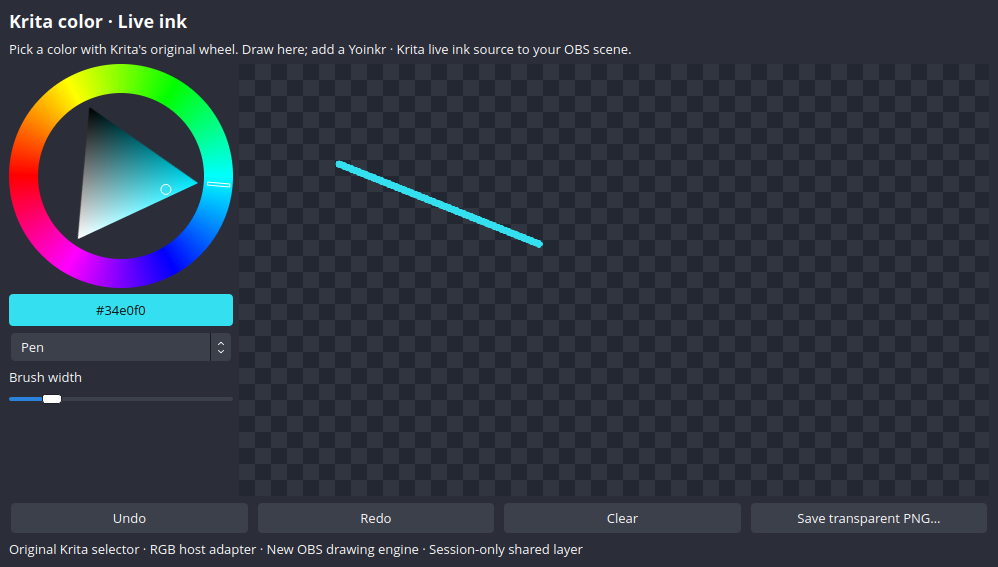

# Krita → OBS: original Qt color wheel, live ink

Use Krita's original triangular color selector in an actual OBS dock, controlling a transparent live annotation source. Choose a hue/saturation/value, draw with pen or marker, erase, undo/redo, clear, or save a transparent PNG.



The selector is recovered **unchanged** from Krita **5.2.9**, commit `ac6cae86d02ce033e81f20f70fdda10aa4fd8dfb`. This is a real Qt widget source transfer into OBS, not a screenshot, imitation wheel or Krita window capture. The ink engine, toolbar, RGB boundary and OBS rendering adapter are new Yoinkr code.

## Quick start

The accepted build lane is **Linux x86-64 / X11**, OBS **30.0.2**, Qt **6.4.2**, and a C++17 compiler. Native acceptance used OBS's Ubuntu build `30.0.2.1-3build1`. A different OBS/Qt ABI requires its own build and acceptance. Windows, macOS, Wayland, other versions and full Krita integration are not verified.

You need Node (the version supported by Yoinkr), `c++`, the matching OBS development SDK with frontend API, Qt 6 Widgets development files and `moc`. Native tests also need Qt Test and Xvfb. This example has no additional npm dependencies and does not require an AI model or account.

From this example directory, with matching OBS/Qt development packages available on the system:

```sh
node acquire.mjs
node build.mjs /
node prepare.mjs /usr
./launch-obs.sh
```

An extracted SDK/distribution can be used without installing system packages:

```sh
node acquire.mjs
node build.mjs /path/to/sdk-prefix
node prepare.mjs /path/to/sdk-prefix/usr
node launch.mjs
```

The SDK prefix must use the Debian/Ubuntu-style `usr/include`, `usr/lib/x86_64-linux-gnu` and `usr/lib/qt6/libexec/moc` layout. The runtime distribution must contain `bin/obs`, `share/obs`, and the required libraries/plugins. Acquisition needs internet; build/prepare are local. Missing dependencies or changed source hashes are refused. `prepare` refuses to overwrite an existing generated runtime.

After preparation, you can also launch from the Yoinkr root with `npm run example:krita`.

## Try the demo

1. The launcher opens the copied OBS application with its own lab profile and installs the compiled module only into that profile. Your original OBS installation and profile are unchanged.
2. The lab adds **Krita live ink** to its current scene. Open **Docks → Krita color · Live ink** if needed; the dock can float or be docked normally.
3. Pick a color on the wheel/triangle and draw in the checkerboard area. The strokes appear in the OBS preview as a transparent source.
4. Place another OBS source beneath the ink source to annotate it. The checkerboard is a dock preview aid; it is **not** part of the stream output.
5. Try pen, translucent marker, eraser, brush width, undo/redo and clear. **Save transparent PNG** opens the normal file chooser.

All source instances share one 1280×720 canvas for the current OBS session. Drawings and history are session-only; save a PNG before closing. History is bounded to 16 images, roughly 60 MiB at this resolution, and texture uploads happen only after the image changes. This is not a claim of a measured performance improvement over another application.

The copied runtime is still dependent on the host OS, graphics drivers and X11; it is not a self-contained operating-system image. The fresh lab skips OBS’s setup wizard and starts without microphone/desktop-audio capture. No streaming account is configured or broadcast started by this example. Configure your own OBS audio/media/output settings if you choose to use them.

## What was actually transferred

Original files, retained byte-for-byte with their notices:

- `libs/widgets/KoTriangleColorSelector.cpp/.h`: wheel/triangle rendering, HSV state, original Qt signals/slots and mouse interaction.
- `libs/widgets/KisColorSelectorInterface.cpp/.h`: original Qt base interface.
- `libs/pigment/KoColorConversions.h`: original included declarations; no conversion implementation is transplanted.

`compat/` is a new **QColor-based RGB host boundary** for Krita's `KoColor` and display-renderer interfaces. It follows the original simple HSV/QColor path, whose source is retained for reference. Krita's pigment engine, ICC profiles, HDR, proofing, canvas, brush presets, paint engines and document model are **not** included. The annotation strokes are new OBS host behavior, not a recovered Krita brush engine.

The original widget targets Krita's Qt environment; this example compiles its unchanged code with Qt 6 and new host services. It does not establish that arbitrary Qt widgets or application features can be copied without dependency adaptation. No binary detouring or whole-application REA reconstruction is claimed by this source-recovery lane.

## Verification and rollback

```sh
YOINKR_XVFB=/absolute/path/to/Xvfb node verify.mjs /path/to/sdk-prefix .local/runtime/bin/obs
```

The verifier creates its own virtual display and test-only OBS configuration. A separate observer module drives the **real Qt widgets** and reads **real GPU-rendered OBS source/scene frames**. It is not loaded by the ordinary launcher.

Accepted checks include:

- Original Krita class identity, signals, wheel interaction, 63 standard HSV combinations and bounds.
- Lab setup, selected-color stroke output, transparency, compositing over another native source, marker/eraser and undo/redo.
- Twelve repeated source instances, dock reopening and clear.
- A second complete OBS session, guarded plugin removal, an actual restored OBS session, and the ordinary portable launcher.
- Source, module and runtime drift refusal; refusal to remove a changed installed module.
- Normal exit and **zero OBS-tracked memory leaks** in all four sessions.

The feature suite has **13 checks**, repeated after restart and through the ordinary launcher, plus **two fresh-launch checks**, **two rollback checks** and **four integrity checks**. Receipts, source frames, screenshots and logs are generated under `.local/verification/`. These checks do not run the complete original Krita application or establish end-to-end color-managed parity with it. The native PNG file chooser, production streaming, long-session performance, pressure/tablet input and other platforms remain unverified.

To remove the module from the normal lab configuration after closing OBS:

```sh
node rollback.mjs
```

This preserves the copied OBS runtime, scene/profile files and your original installation. Scenes may retain references to the removed source; remove those through OBS if desired. Running `launch.mjs` installs the example again.

## Files and sharing

The public example contains the pinned recipe, acquisition/build/prepare/launch/rollback tools, new compatibility/host code, native test source and one curated synthetic preview. Everything generated stays under ignored `.local/`:

```text
.local/upstream/       # original source + license files
.local/build/          # module, corresponding source, BUILD.json hashes
.local/runtime/        # copied OBS application, libraries/data, RUNTIME.json
.local/lab-config/     # normal demo profile and owned plugin
.local/verify-config/  # separate test configuration and observer
.local/verification/  # generated receipts, screenshots, scene frames and logs
```

Krita's recovered widget/interface files retain their LGPL notices. Full applicable license texts accompany the generated source. New host code is GPLv3 under [Yoinkr's license](../../LICENSE). OBS, Qt and copied runtime dependencies retain their own licenses. The generated runtime and recovered payloads are not committed or included in npm. If redistributing a built derivative separately, retain all applicable notices and corresponding source; the source-only repository does not grant new rights to third-party applications.
